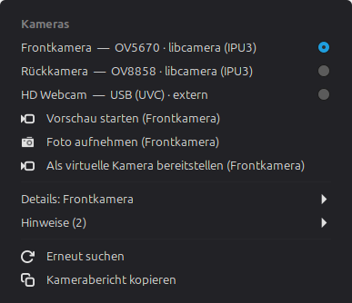
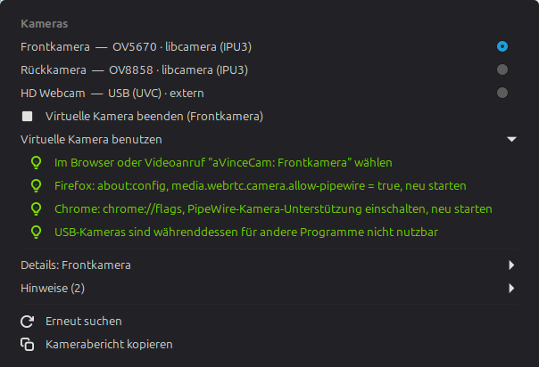
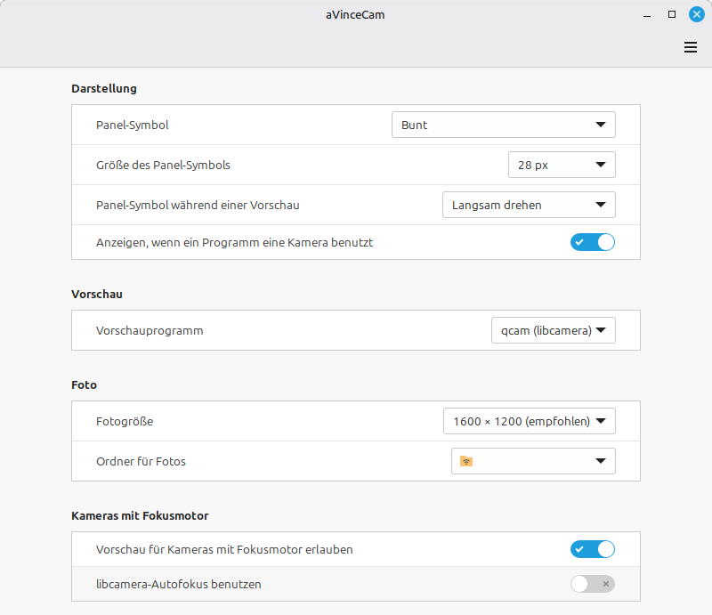

# aVinceCam

**Camera Control for Linux** – ein schlankes Cinnamon-Applet, das die Kameras eines
Rechners erkennt, verständlich anzeigt, eine Vorschau startet, Fotos aufnimmt und Kameras
für Browser und Videoanrufe bereitstellt.

> Version 0.9.2 – getestet auf einem Gerät (Intel-IPU3-2-in-1 mit Front- und Rückkamera
> sowie USB-Webcam, Linux Mint 22, Cinnamon 6.6). Rückmeldungen von anderen Rechnern sind
> willkommen.

Ausführliche Beschreibung (Englisch): [README.md](README.md)

## Funktionen

- **Ein lesbarer Eintrag pro Kamera** – USB-Webcams (V4L2/UVC) und libcamera-Kameras
  (z. B. Intel IPU3/IPU6 oder andere MIPI-Sensoren) mit Lage (vorn/hinten), Modell und
  Hinweisen
- **Details auf Wunsch** – Größen, Bildraten, Sensorgröße; beim Öffnen des Menüs wird keine
  Kamera eingeschaltet
- **Vorschau** mit vorhandenen Programmen (qcam, GStreamer, VLC); aVinceCam beendet nur
  die eigene Vorschau
- **Foto aufnehmen**: libcamera-Kameras als PNG nach dem Einregeln der Belichtung,
  USB-Webcams als JPEG (nur das Gerät der Webcam wird geöffnet)
- **Virtuelle Kamera** über PipeWire für Browser und Videoanrufe
- **Kamera in Benutzung**: roter Punkt am Panel-Symbol, wenn ein Programm eine Kamera
  nutzt – ohne ein Gerät zu öffnen
- **Kamerabericht** in die Zwischenablage
- Deutsch und Englisch

## Bildschirmfotos

<p>
  
  
</p>



Weitere Bilder (Details, Hinweise) unter `assets/screenshots/de/`.

## Sicherheit

Kein Hintergrunddienst, keine Root-Rechte, keine Änderungen an Treibern, Paketen oder
Systemeinstellungen. Fokusmotoren und andere Teilgeräte öffnet aVinceCam nie. Kameras mit
Fokusmotor sind standardmäßig gesperrt; freigegeben laufen sie ohne den libcamera-Autofokus
(feste Schärfe), außer „libcamera-Autofokus benutzen“ ist eingeschaltet.

## Installation

```
git clone https://github.com/aVince-Industrietechnik/aVinceCam.git
cd aVinceCam
scripts/install.sh
```

Danach das Applet über *Systemeinstellungen → Applets* hinzufügen. Voraussetzungen,
Entfernen und Browser-Einstellungen: [README.md](README.md),
[docs/installation.md](docs/installation.md).

## Lizenz

Copyright © 2026 Angelo Vincenti

GPL-3.0-or-later, siehe [LICENSE](LICENSE).
