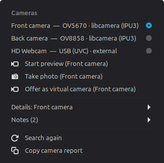
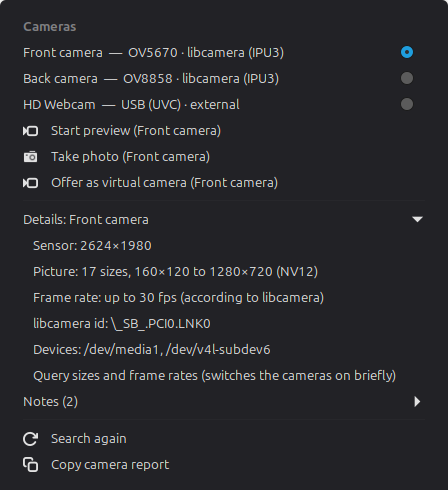
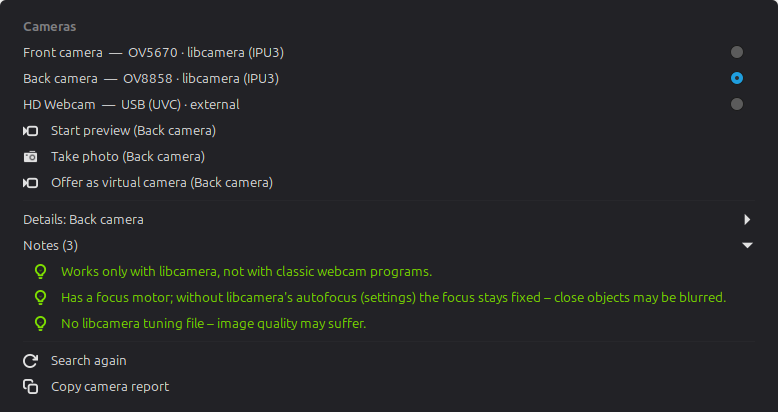
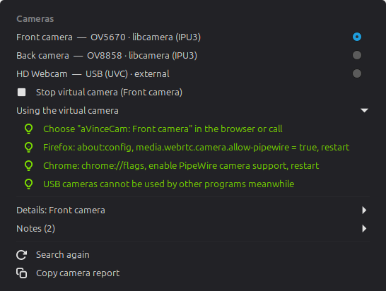
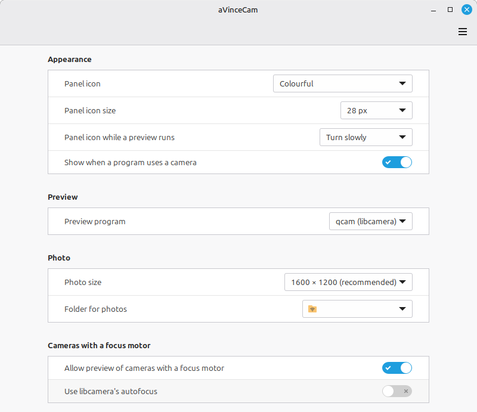

# aVinceCam

**Camera Control for Linux** – a lightweight Cinnamon applet that finds the cameras of a
computer, shows what they are and lets you preview them, take photos and offer them to
browsers and video calls.

> Version 0.9.0 – tested on one machine (Intel IPU3 2-in-1 with front and back camera
> plus a USB webcam, Linux Mint 22, Cinnamon 6.6). Reports from other machines are welcome.

Deutsche Kurzfassung: [README.de.md](README.de.md)

## Features

- **One readable entry per camera** – USB webcams (V4L2/UVC) and libcamera cameras such
  as Intel IPU3/IPU6 or other MIPI sensors, with front/back position, model and hints
  (missing tuning file, focus motor, missing tools)
- **Details on request** – sizes, frame rates and sensor size; querying is never done
  when the menu opens, because on some machines it powers up all cameras
- **Preview** with existing programs: `qcam` or GStreamer for libcamera cameras, VLC (or
  GStreamer) for USB cameras; aVinceCam stops only the preview it started
- **Photo** button for libcamera cameras: lets the exposure settle (about 30 frames) and
  saves the last frame as PNG
- **Virtual camera**: offers a libcamera camera through PipeWire as
  “aVinceCam: &lt;name&gt;”, so browsers and web video calls can use it
- **Camera in use**: a red dot on the panel icon and a line in the menu show when any
  program uses a camera – watched with inotify, no device is opened
- **Camera report** to the clipboard, for bug reports and forums
- English and German

## Screenshots

<p>
  
  
</p>

Notes for a camera with a focus motor:



The virtual camera with its hints for browsers:





The screenshots were taken with the simulated cameras of the test suite.

## Safety by design

- No background service, no root rights, no changes to drivers, packages or system
  configuration. Everything is installed in your home folder.
- Lens motors and other camera sub-devices are never opened by aVinceCam.
- Cameras with a focus motor are locked by default. When you allow them, aVinceCam runs
  them **without libcamera's autofocus** (a copy of the tuning file without the `Af`
  algorithm, used only by the programs aVinceCam starts): the focus then stays fixed.
  On machines whose focus motor works, the setting “Use libcamera's autofocus” switches
  it back on.
- The applet runs inside Cinnamon and never touches hardware itself; all device access
  happens in a short-lived Python process with time limits.

Reasons and measurements: [docs/decisions.md](docs/decisions.md).

## Requirements

- Cinnamon 6.x (tested: 6.6), Python 3 – the core uses the standard library only
- libcamera cameras: `libcamera-tools` (`cam`, `qcam`); for the GStreamer preview also
  `gstreamer1.0-libcamera`, for the virtual camera additionally `gstreamer1.0-pipewire`,
  `python3-gi` and `gir1.2-gstreamer-1.0`
- USB cameras: `vlc` for the preview (recommended), otherwise `gstreamer1.0-tools` and
  `gstreamer1.0-plugins-good`
- Translations: `gettext` (for `msgfmt` during installation)

## Installation

```
git clone https://github.com/aVince-Industrietechnik/aVinceCam.git
cd aVinceCam
scripts/install.sh
```

Then add the applet via *System Settings → Applets*. After an update restart Cinnamon
(Alt+F2, `r`, Enter on X11). Removal and details: [docs/installation.md](docs/installation.md).

## Using the virtual camera in a browser

Choose *Offer as virtual camera* in the applet menu, then select “aVinceCam: …” as camera
in the browser.

- **Firefox**: `about:config` → `media.webrtc.camera.allow-pipewire` = `true`, restart
- **Chrome/Chromium**: `chrome://flags` → enable PipeWire camera support, restart

While the virtual camera runs, libcamera keeps all cameras it knows open – USB cameras
then cannot be used by other programs.

## Settings

Panel icon (colourful or single-colour) and its size · preview program for libcamera
cameras (qcam or GStreamer) · photo size and folder · panel icon while a preview runs ·
show when a program uses a camera · allow cameras with a focus motor · use libcamera's
autofocus.

## Known limitations

Image quality depends on the libcamera tuning file and the camera module; fixed-focus
modules are often soft at full size. See [docs/known-limitations.md](docs/known-limitations.md).

## Development

- Architecture: [docs/architecture.md](docs/architecture.md), core interface:
  [docs/json-interface.md](docs/json-interface.md)
- Tests need no camera: `bash tests/run-tests.sh` and
  `cjs tests/applet/test_applet.js .`
- `scripts/dev-link.sh link` links the applet from the repository for development

## License

Copyright © 2026 Angelo Vincenti

GPL-3.0-or-later, see [LICENSE](LICENSE).
